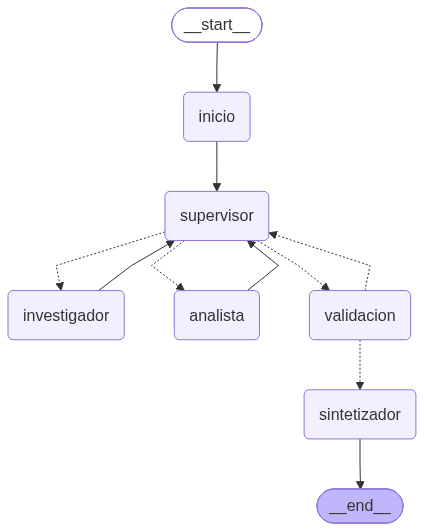
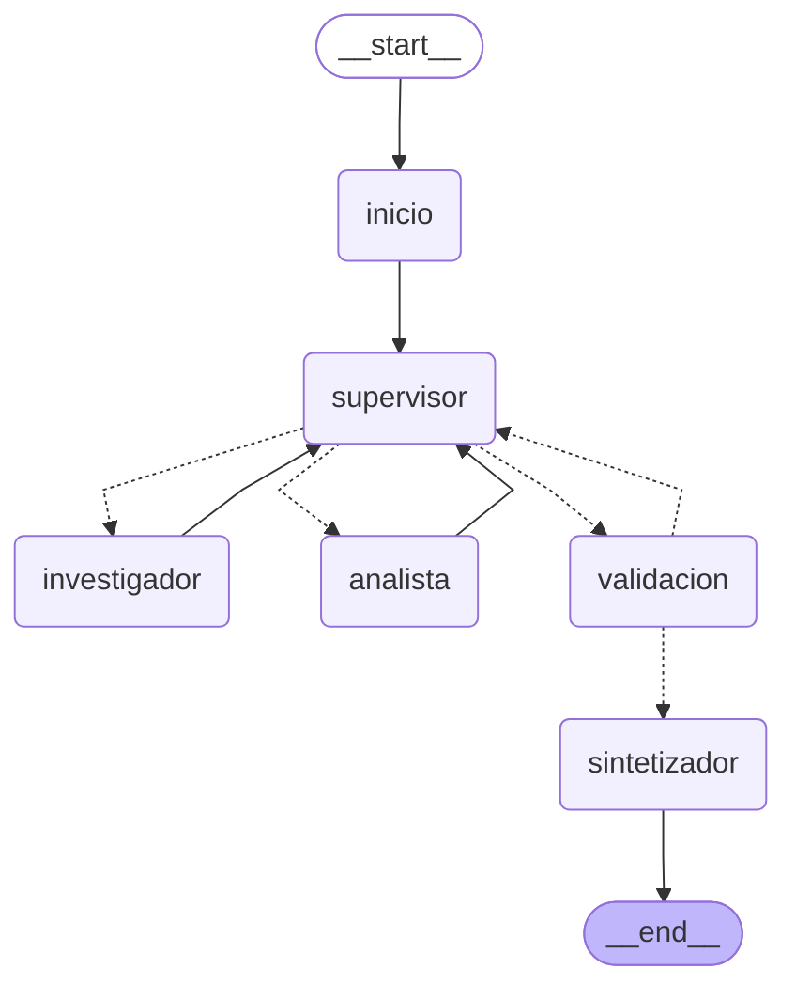

# Orquestador multi-agente de análisis e investigación

Pre-entrega 6 — AI Engineering (Coderhouse).

Sistema **jerárquico** construido con **LangGraph**: un **Supervisor** recibe la consulta, delega en un
**Investigador** (busca en la base vectorial ChromaDB de la pre-entrega 3) y en un **Analista** (hace
los cálculos), valida el resultado con una rúbrica y cierra con una **síntesis** final. El estado
compartido registra qué agente aportó qué información. El checkpointer SQLite de la pre-entrega 5
permite seguir la conversación por `thread_id`.

El dominio es la documentación técnica de la "Plataforma de Pedidos" (arquitectura, monitoreo y
alertas, normativa de despliegue, runbook de incidentes). Responder una consulta como "tenemos 87
conexiones en PgBouncer, ¿ya salta la alerta y cuánto margen queda?" exige dos especialidades:
**encontrar** los umbrales en la documentación y **calcular** contra ellos.

## Evidencia de ejecución

| Qué | Resultado | Evidencia |
|---|---|---|
| Demo con API real | 4 turnos con Anthropic `claude-sonnet-5-5` (14/10/2026). En los 4, el supervisor delegó primero en el investigador y después en el analista (salvo el turno 4, sin datos). Ningún especialista falló | [`traces/traza_delegacion.log`](traces/traza_delegacion.log), [`traces/traza_delegacion.json`](traces/traza_delegacion.json) |
| Notebook de demostración | Ejecutado de punta a punta, sin errores, con las salidas guardadas: diagrama, delegación paso a paso, parcelas del estado, respuesta y seguimiento en el mismo thread | [`demo.ipynb`](demo.ipynb) |
| Tests (`pytest`) | **36 passed**, sin API key (Python 3.12.10, Windows 10) | [`traces/resultado_tests.txt`](traces/resultado_tests.txt) |
| Tipado (`mypy --strict`) | `Success: no issues found in 12 source files` | [`traces/resultado_tests.txt`](traces/resultado_tests.txt) |
| Diagrama del grafo | Generado con `graph.get_graph().draw_mermaid_png()` | [`docs/grafo.png`](docs/grafo.png), [`docs/grafo.mmd`](docs/grafo.mmd) |

Para reproducirlo: `pytest` (no usa API key) y `python main.py` (demo; usa la key del `.env`).

## Diagrama del grafo



El mismo grafo en Mermaid (salida de `graph.get_graph().draw_mermaid()`, sin editar). Las flechas
punteadas son aristas condicionales:



| Nodo | Qué hace | Escribe en el estado |
|---|---|---|
| `inicio` | Toma la última pregunta y reinicia los campos de control del turno | `turno`, `pregunta`, contadores |
| `supervisor` | Router: decide quién interviene o si se finaliza (salida estructurada `DecisionSupervisor`) | `next_agent`, `instruccion`, `delegaciones` |
| `investigador` | Agente ReAct con tools de búsqueda en Chroma | `investigaciones` |
| `analista` | Agente ReAct con tools de cálculo | `analisis` |
| `validacion` | Rúbrica de suficiencia en código; aprueba o devuelve al supervisor | `feedback_validacion`, `task_completed` |
| `sintetizador` | Redacta la respuesta final con los resultados validados | `respuesta_final`, `messages` |

Todos los nodos agregan además una entrada a la bitácora `contribuciones`.

## Por qué una topología jerárquica

El Módulo 6 recomienda la jerarquía cuando el flujo es semi-determinístico, se necesita un validador
antes de responder y el control de costos y la trazabilidad importan. Las tres condiciones se dan acá:

- **El orden de trabajo es casi siempre el mismo**: primero encontrar los datos, después calcular,
  al final redactar. No es un problema exploratorio donde convenga que los agentes se organicen solos.
- **Hay dependencia de datos**: el analista no puede trabajar sin lo que encuentra el investigador.
  En una red de pares, el analista tendría que "darse cuenta" de cuándo hay datos nuevos (coreografía).
  Acá el supervisor lo decide explícitamente.
- **La respuesta tiene que ser verificable**: cifras con su fuente y cuentas correctas. Un punto
  central de control (supervisor + validación) es el lugar natural para esa revisión.
- **Auditoría y costo**: cada decisión de ruteo queda registrada con su razonamiento, y los topes
  de delegaciones acotan cuántas llamadas al LLM puede hacer un turno.

El riesgo de esta topología es que el supervisor sea un cuello de botella o un punto único de falla.
Se mitiga así: el supervisor solo coordina (no busca ni calcula), recibe un resumen compacto en lugar
del historial completo, y si falla hay un fail-safe en código (ver más abajo).

## Cómo cumple la consigna

| Requisito | Implementación | Archivo |
|---|---|---|
| Topología jerárquica con Supervisor router | Nodo `supervisor`. Los especialistas siempre vuelven a él (`add_edge(especialista, "supervisor")`) | `graph.py`, `agents/supervisor.py` |
| Agente de Búsqueda/Investigación con fuentes externas | `create_react_agent` con `buscar_documentacion` y `listar_documentos` sobre ChromaDB (la base de la pre-entrega 3) | `agents/research_agent.py`, `tools/custom_tools.py` |
| Agente de Análisis/Cómputo | `create_react_agent` con `calcular`, `porcentaje` y `comparar_con_umbral`, más la verificación de cada cálculo en código | `agents/analyst_agent.py`, `tools/custom_tools.py` |
| Herramientas acotadas por agente | El investigador no puede calcular y el analista no puede buscar (lo verifica un test) | `tools/custom_tools.py`, `tests/test_tools.py` |
| Estado compartido estructurado | `OrquestadorState(MessagesState)` con `next_agent`, `task_completed`, una parcela por agente y la bitácora `contribuciones` | `state.py` |
| Supervisor que decide si refinar o finalizar | Rúbrica de suficiencia en su prompt, más el nodo `validacion` que puede devolverle el turno | `agents/supervisor.py` |
| `StateGraph` con aristas condicionales que retornan un `Literal` | `rutear_supervisor(...) -> DestinoSupervisor` (`Literal["investigador", "analista", "validacion"]`) y `rutear_validacion(...) -> DestinoValidacion` | `agents/supervisor.py`, `graph.py` |
| Nodo de Validation antes del END | `validacion`: rúbrica en código (ver abajo) | `agents/supervisor.py` |
| Fase de síntesis final | Nodo `sintetizador` | `agents/analyst_agent.py` |
| Grafo principal | `build_graph()` | `graph.py` |
| Prueba de interacción (Investigador → Analista → cierre) | Demo de 4 turnos y notebook | `main.py`, `demo.ipynb` |
| README con diagrama Mermaid | Esta página y `docs/grafo.png` | `README.md`, `docs/` |

## Estructura del repositorio

Sigue la estructura propuesta para la entrega:

```
ai-engineering-6/
├── agents/
│   ├── __init__.py           # Piezas comunes: create_react_agent, salida estructurada, errores fatales
│   ├── supervisor.py         # Nodo supervisor (decisión dinámica con Literal) + nodo de validación y topes
│   ├── research_agent.py     # Especialista 1: investigación (búsqueda en la base vectorial)
│   └── analyst_agent.py      # Especialista 2: análisis/cómputo + nodo de síntesis final
├── tools/
│   ├── __init__.py
│   └── custom_tools.py       # Herramientas @tool de ambos especialistas + ingesta/búsqueda en ChromaDB
├── state.py                  # Esquema de datos compartido (estado del StateGraph + contratos Pydantic)
├── graph.py                  # Ensamblado del StateGraph, nodos, aristas condicionales, LLM por rol, checkpointer
├── main.py                   # Punto de entrada: demo que genera la traza y chat interactivo
├── demo.ipynb                # Notebook con la corrida de demostración
├── pyproject.toml / requirements.txt
├── .env.example
└── README.md                 # Topología, diagrama Mermaid y decisiones de diseño
```

Además:

```
data/docs/   # Los 4 documentos de la pre-entrega 3 (fuente del investigador)
tests/       # 36 tests offline (LLM falso; grafo, tools, Chroma y SQLite reales)
traces/      # Traza de la demo (.log y .json) y salida de pytest/mypy
docs/        # Diagrama del grafo (PNG y Mermaid)
```

El nodo de validación vive en `agents/supervisor.py` porque es la segunda mitad del control de
calidad del supervisor. La síntesis final vive en `agents/analyst_agent.py`, que la estructura
propuesta define como "análisis / síntesis".

## Estado compartido (`state.py`)

`OrquestadorState` hereda de `MessagesState`. Sigue las reglas de la Unidad 3: cada agente escribe
solo en su parcela, y todo lo que produce un LLM se valida con Pydantic antes de entrar al estado.

| Campo | Lo escribe | Para qué |
|---|---|---|
| `messages` | `sintetizador` (y el usuario) | Solo la conversación: preguntas y respuestas finales |
| `next_agent`, `instruccion`, `delegaciones` | `supervisor` | Ruteo y la instrucción autocontenida para el especialista |
| `investigaciones` | `investigador` | `RegistroInvestigacion`: resultado validado, fuentes que devolvió la búsqueda y fuentes no verificadas |
| `analisis` | `analista` | `RegistroAnalisis`: resultado validado y la re-verificación de cada cálculo |
| `feedback_validacion`, `rechazos_validacion`, `task_completed` | `validacion` | Rúbrica: qué falta y si el turno puede cerrarse |
| `limitaciones` | `supervisor`, `validacion` | Lo que no se pudo resolver (se informa en la respuesta) |
| `respuesta_final` | `sintetizador` | Respuesta del turno |
| `contribuciones` | todos | Bitácora: `turno`, `paso`, `agente`, `accion`, `detalle`, `fuentes`, `duracion_s` |

Decisiones de diseño:

- **Sin estado mutable compartido**: los nodos devuelven listas nuevas y el reducer `operator.add`
  las concatena. Nadie hace `.append()` sobre el estado.
- **Las parcelas se acumulan por turno**: cada registro lleva su número de `turno`, así que la
  historia del thread queda auditable y cada nodo filtra el turno actual con `del_turno()`.
- **Allowlist del checkpoint**: LangGraph bloquea por defecto la deserialización de clases propias
  guardadas en un checkpoint. `graph.serializador()` registra explícitamente los tipos del estado
  (`TIPOS_SERIALIZABLES`) en lugar de abrir la deserialización a cualquier clase.
- Un test (`test_cada_agente_escribe_solo_su_parcela`) recorre los updates de cada nodo y falla si
  alguno escribe fuera de su parcela.

## Los especialistas

Los dos especialistas usan `create_react_agent` y razonan en su propio subgrafo ReAct. Sus mensajes
internos (tool calls, resultados) **no** pasan al estado compartido: al estado solo llega el
resultado validado.

### Investigador

| Tool | Qué hace |
|---|---|
| `buscar_documentacion(consulta, documento?)` | Búsqueda semántica en Chroma (top 5). Devuelve `fuente`, `seccion`, `similitud` y `texto` de cada fragmento. La fuente sale de la **metadata**, no del LLM |
| `listar_documentos()` | Documentos indexados y sus secciones, para filtrar la búsqueda por documento |

Salida: `Investigacion` (`resumen`, `hallazgos[{dato, fuente}]`, `sin_informacion`). Si el LLM cita una
fuente que la búsqueda no devolvió, queda en `fuentes_no_verificadas`, ese hallazgo no llega al
analista y la validación lo rechaza.

### Analista

| Tool | Qué hace |
|---|---|
| `calcular(expresion)` | Aritmética segura: recorre el AST y solo admite números, `+ - * / // % **`, paréntesis y `round/min/max/abs/sqrt`. Nunca usa `eval` |
| `porcentaje(valor, total)` | Porcentaje de uso y margen restante |
| `comparar_con_umbral(valor, umbral, condicion)` | Si un valor dispara un umbral, y por cuánto |

Salida: `Analisis` (`calculos[{descripcion, expresion, resultado}]`, `conclusiones`, `datos_faltantes`,
`supuestos`, `inconsistencias`). **Cada cálculo se vuelve a evaluar en código** (`verificar_calculos`):
si el LLM declara un resultado que no coincide con su propia expresión, la validación lo rechaza.

Las tools heredan las prácticas de la pre-entrega 5: `args_schema` Pydantic con `extra="forbid"`,
docstrings que dicen cuándo usarlas y **cuándo no**, argumentos inválidos que vuelven como error
(la tool no se ejecuta) y un timeout en la búsqueda.

## Flujo de supervisión

### El supervisor

Su prompt responde la pregunta de la consigna: *"Dada la conversación actual, ¿quién debe intervenir
ahora o es momento de finalizar?"*. Devuelve una `DecisionSupervisor` validada
(`razonamiento`, `siguiente: Literal["investigador", "analista", "FINALIZAR"]`, `instruccion`), y el
código la mapea a los nombres de los nodos. Incluye esta **rúbrica de suficiencia**:

1. Cada parte de la pregunta que depende de la documentación tiene al menos un hallazgo con fuente.
2. Cada cifra o comparación pedida la calculó el analista, sin errores de verificación.
3. No hay datos faltantes que el investigador pueda conseguir (los supuestos no bloquean).
4. Si el investigador no encontró información sobre el tema central, finalizar: la respuesta dice "no lo sé".
5. Ante inconsistencias, pedir una aclaración al investigador una sola vez.
6. Resolver las observaciones de la validación antes de finalizar.

### La validación

El LLM puede creer que terminó sin que sea así. El nodo `validacion` revisa la rúbrica **en código**
antes del END:

- hay una investigación exitosa con al menos un hallazgo cuya fuente devolvió la búsqueda;
- el investigador no citó fuentes que la búsqueda no devolvió;
- hay un análisis **posterior** a la última investigación (si no, está desactualizado);
- todos los cálculos coinciden al re-evaluarlos;
- el análisis no reporta datos faltantes de la documentación.

Si algo falla, devuelve el turno al supervisor con las observaciones. El supervisor decide si
re-delega o si esos problemas no tienen solución.

### Anti "supervisor infinito"

Además de la rúbrica, hay topes **en código** que el LLM no puede saltear (`agents/supervisor.py`):

| Tope | Valor | Qué pasa al alcanzarlo |
|---|---|---|
| Delegaciones por turno | 6 | El supervisor deja de delegar y pasa a validación; se informa como limitación |
| Delegaciones al mismo especialista | 3 (1 + 2 refinamientos) | Ídem |
| Rechazos de la validación | 2 | Se responde con lo obtenido y se informan las limitaciones |
| Mismos problemas que el rechazo anterior | — | El supervisor ya los evaluó y finalizó igual: no se insiste |
| Supervisor sin decisión válida (tras 2 intentos con `.with_retry`) | — | Fail-safe: pasa a validación en lugar de colgarse |
| `recursion_limit` del grafo / de cada especialista | 40 / 12 | Red de seguridad de LangGraph |

Lo cubren los tests de `TestCondicionDeParada`: un supervisor que pide siempre al investigador, uno
que alterna especialistas sin finalizar nunca y uno que siempre falla. Los tres terminan con respuesta.

## Contaminación de contexto: quién ve qué

| Agente | Recibe | No recibe |
|---|---|---|
| Supervisor | Resumen compacto: conversación previa (preguntas y respuestas finales), trabajo del turno, observaciones de la validación, presupuesto | Mensajes internos de los especialistas, resultados crudos de las tools |
| Investigador | Solo la instrucción del supervisor | La conversación, la pregunta original, el trabajo del analista |
| Analista | La instrucción y los hallazgos **verificados** del turno (`dato [fuente]`) | La conversación, el JSON crudo de la búsqueda, hallazgos con fuente no verificada |
| Sintetizador | Pregunta, conversación previa y resultados validados | Mensajes internos |

Por eso la `instruccion` del supervisor tiene que ser **autocontenida**: en un seguimiento como
"¿y si subimos el límite?", el supervisor le pasa al investigador y al analista las cifras del turno
anterior. Lo verifican los tests de `TestAislamientoDeContexto`, que inspeccionan lo que recibe cada LLM.

## Conflictos entre agentes

| Conflicto | Cómo se maneja |
|---|---|
| Dos agentes escriben el mismo dato | No puede pasar: cada uno escribe solo en su parcela (lo verifica un test) |
| El investigador "inventa" una fuente | Se compara contra la metadata que devolvió Chroma: queda en `fuentes_no_verificadas`, no llega al analista y la validación pide re-investigar |
| El analista se equivoca en una cuenta | Se re-evalúa su expresión en código; si no coincide, la validación rechaza y el supervisor le pide corregirla (test `test_calculo_erroneo_se_rechaza_y_el_analista_lo_refina`) |
| Investigación nueva después del análisis | La validación detecta que el análisis quedó desactualizado y pide actualizarlo |
| Datos contradictorios en la documentación | El analista los lista en `inconsistencias`; el supervisor pide una aclaración y, si persisten, se informan en la respuesta |
| Al analista le falta un dato | `datos_faltantes` (buscable: vuelve al investigador) se distingue de `supuestos` (solo el usuario puede confirmarlo: se informa y no bloquea) |
| Supervisor y validación no coinciden | La validación manda, pero con tope: si encuentra los mismos problemas que el supervisor ya evaluó, aprueba con limitaciones |
| Falla un especialista (excepción, salida inválida) | Se captura en el nodo y queda en el estado como `error`. El supervisor decide si reintenta. Los errores de credenciales sí cortan la ejecución |

## Qué se reutiliza de las pre-entregas anteriores

| Pre-entrega | Qué se usa acá |
|---|---|
| 1 — Clientes de LLM | Proveedor configurable (`LLM_PROVIDER=anthropic|openai`) y, ahora, un modelo por rol (`LLM_MODEL_<ROL>`) |
| 2 — Pipeline validado | Contratos Pydantic, `.with_structured_output()` + `.with_retry()` en supervisor y especialistas, y logs del proceso |
| 3 — RAG local | La misma base: ChromaDB persistente, los mismos 4 documentos, el mismo modelo de embeddings para indexar y consultar, ingesta idempotente, fuentes desde la metadata, top-k acotado y "no lo sé" fuera de contexto |
| 4 — RAG escalable | Metadata rica por fragmento (fuente y sección) y filtro por documento en la búsqueda |
| 5 — Agente ReAct | `MessagesState`, tools con `args_schema` y "cuándo NO usarla", errores como observación, timeouts, `AsyncSqliteSaver` + `thread_id`, `recursion_limit`, trazas `.log`/`.json`, tests offline con LLM falso y `mypy --strict` |

## Hallazgos durante el desarrollo

La demo con la API real y el notebook encontraron tres problemas que los tests con LLM falso no
mostraban. Los tres están corregidos y cubiertos por tests:

1. **La búsqueda no encontraba la regla de rollback del canario.** El modelo de embeddings
   (`paraphrase-multilingual-MiniLM-L12-v2`) solo lee los primeros **128 tokens** de cada texto, y la
   sección "Proceso de despliegue" tenía 282, con la regla al final. Con los fragmentos de 500 tokens de
   la pre-entrega 3, esa regla nunca entraba en el embedding. Ahora los fragmentos se ajustan a la
   ventana del modelo y cada subfragmento lleva adelante la ruta de encabezados de su sección. La
   consulta "rollback automático del canario" pasó de no traer `normativa_despliegue.md` en el top 4
   a traerlo primero (similitud 0,61). Test: `test_fragmentos_entran_en_la_ventana_del_modelo_y_llevan_su_seccion`.
2. **Claude rechazaba la salida estructurada de `create_react_agent`.** Su `response_format` le envía al
   modelo una conversación que termina en un mensaje del asistente, y `claude-sonnet-5-5` responde
   *"does not support assistant message prefill"*. Ahora el ciclo ReAct sigue usando `create_react_agent`
   y la salida estructurada se pide aparte, con `method="json_schema"` (salida estructurada nativa) y una
   transcripción en texto del ciclo. Reenviar los mensajes originales también fallaba: incluyen bloques
   de *thinking* firmados para otra lista de tools.
3. **`calcular("round(87 / 150 * 100, 1)")` fallaba.** El evaluador pasaba todas las constantes a float
   y `round()` exige un entero como segundo argumento. Además, ese `TypeError` no se capturaba. El
   sistema se recuperó solo (el supervisor re-delegó hasta que el analista lo resolvió), pero ahora los
   enteros se conservan y cualquier error de operación vuelve como observación.

## Cómo levantar el entorno

Requiere Python 3.12 o superior.

### Linux / macOS

```bash
git clone https://github.com/pantonini2011/ai-engineering-6.git
cd ai-engineering-6

python3.12 -m venv .venv
source .venv/bin/activate
pip install -r requirements.txt    # versiones exactas probadas

cp .env.example .env               # y completá ANTHROPIC_API_KEY u OPENAI_API_KEY
```

### Windows (PowerShell)

```powershell
git clone https://github.com/pantonini2011/ai-engineering-6.git
cd ai-engineering-6

py -3.12 -m venv .venv
.\.venv\Scripts\Activate.ps1
pip install -r requirements.txt

copy .env.example .env             # y completá ANTHROPIC_API_KEY u OPENAI_API_KEY
```

Si `Activate.ps1` falla con *"la ejecución de scripts está deshabilitada en este sistema"*, ejecutá
una sola vez `Set-ExecutionPolicy -Scope CurrentUser RemoteSigned`. En `cmd`, activá con
`.venv\Scripts\activate.bat`.

La primera ejecución descarga el modelo de embeddings (~470 MB, una sola vez) e indexa los documentos
en `./vectorstore`. Las siguientes ejecuciones reutilizan la colección.

### Configuración (`.env`)

| Variable | Valor | Obligatoria |
|---|---|---|
| `LLM_PROVIDER` | `anthropic` (default) u `openai` | No |
| `LLM_MODEL` | Modelo para todos los roles (default `claude-sonnet-5-5` / `gpt-4o-mini`) | No |
| `LLM_MODEL_SUPERVISOR`, `LLM_MODEL_INVESTIGADOR`, `LLM_MODEL_ANALISTA`, `LLM_MODEL_SINTETIZADOR` | Un modelo distinto por rol (ej. supervisor más capaz y especialistas más baratos) | No |
| `ANTHROPIC_API_KEY` / `OPENAI_API_KEY` | La del proveedor elegido | Sí (para la demo) |

El `.env` está en `.gitignore` y nunca se sube. Los embeddings corren localmente, sin API key.

## Cómo ejecutarlo

Con el venv activado y desde la raíz del repo:

```bash
# Demo de 4 turnos: genera traces/traza_delegacion.log y traces/traza_delegacion.json
python main.py

# Chat interactivo con memoria por thread_id
python main.py --chat --thread-id mi-sesion

# Volver a indexar data/docs en Chroma (por ejemplo, después de cambiar un documento)
python main.py --reindexar

# Tests offline (sin API key) y tipado
pytest
mypy                 # revisa los archivos listados en pyproject.toml
```

El notebook [`demo.ipynb`](demo.ipynb) se abre con Jupyter o VS Code, usando el
kernel del `.venv` y la raíz del repo como directorio de trabajo.

## Traza de ejemplo

La demo ejecuta 4 turnos (`DEMO` en `main.py`):

| Thread | Pregunta | Qué demuestra |
|---|---|---|
| `sesion-pool` | 87 conexiones en PgBouncer hace 3 min: ¿salta la alerta?, ¿qué % y margen?, ¿qué dice el runbook? | Investigador (umbral, límite, runbook) → Analista (87%, +7 sobre el umbral, margen de 13) → validación → síntesis |
| `sesion-pool` | "Si subimos temporalmente el límite, ¿a qué % quedarían esas mismas conexiones?" | Memoria: "esas mismas conexiones" se resuelve con el turno anterior (58% con límite 150; 33 conexiones más antes de la alerta) |
| `sesion-canario` | Canario con 1,6% de 5xx durante 6 min: ¿rollback?, ¿alerta? | Dos documentos y dos umbrales: no revierte (umbral >2%) pero sí alerta (>1% por 5 min) |
| `sesion-fuera` | Cotización del dólar y costo de servidores | El investigador no encuentra nada → el supervisor finaliza sin llamar al analista → "No lo sé" |

Fragmento del primer turno ([`traces/traza_delegacion.log`](traces/traza_delegacion.log); las líneas
`HTTP Request` de ese archivo marcan cada llamada al LLM):

```
[sesion-pool] Usuario: Hoy PgBouncer tiene 87 conexiones activas sostenidas hace 3 minutos. ¿Ya debería ...
  [paso 1] inicio → recibió la pregunta
  [paso 2] supervisor → delegó a investigador: Nadie intervino todavía: faltan los datos de la documentación ...
  [paso 3] investigador → investigó (9 hallazgos): La documentación fija el límite del pool de PgBouncer en 100 ...
           [fuentes: monitoreo_alertas.md, arquitectura_sistema.md, runbook_incidentes.md]
  [paso 4] supervisor → delegó a analista: El investigador ya aportó con fuente el límite (100), el umbral de alerta (80% ...
  [paso 5] analista → analizó (6 cálculos, 0 con error): El uso del pool es 87% (87 de 100 conexiones), 7 por encima ...
  [paso 6] supervisor → envió a validación: decidió finalizar: La rúbrica se cumple ...
  [paso 7] validacion → rechazó (1/2): Al análisis le faltan datos: Severidad exacta de la alerta de uso superior al 80% ...
  [paso 8] supervisor → envió a validación: decidió finalizar: El investigador aportó los hallazgos con fuente ...
  [paso 9] validacion → aprobó con limitaciones
  [paso 10] sintetizador → redactó la respuesta final
```

Respuesta final (resumida):

> **Sí, la alerta ya debería haber saltado.** Uso del pool: 87 / 100 × 100 = **87%** del límite de 100
> conexiones [arquitectura_sistema.md]. **Margen:** 100 − 87 = **13 conexiones**. La alerta se dispara al
> superar el 80% sostenido por más de 2 minutos [monitoreo_alertas.md]: las 87 superan las 80 por 7, y
> 3 − 2 = 1 minuto por encima de la duración mínima. El runbook indica verificar el dashboard de PgBouncer,
> buscar queries colgadas con `pg_stat_activity` y, si es solo volumen, escalar réplicas o subir
> temporalmente el límite a 150 [runbook_incidentes.md].
> *Limitaciones: no se puede confirmar que la alerta se haya disparado en el sistema real; la documentación
> no aclara la severidad exacta de la alerta del 80% ...*

El `.json` tiene, por turno, cada paso de la bitácora y lo que cada especialista dejó en su parcela:
hallazgos con fuente, cálculos con su verificación, delegaciones y rechazos.

## Comportamiento observado y límites

- **Un rechazo de validación por turno es habitual.** En 3 de los 4 turnos, el analista reportó como
  "dato faltante" algo que la documentación no contiene (por ejemplo, la severidad exacta de la alerta del 80%).
  La validación lo rechaza una vez, el supervisor responde que no se puede conseguir y la validación
  aprueba con limitaciones. Cuesta una llamada extra al supervisor, y a cambio esas limitaciones
  aparecen en la respuesta en lugar de perderse.
- **El supervisor es el cuello de botella**: cada paso pasa por él. Con dos especialistas no pesa;
  con más, convendría que el supervisor planifique varios pasos por llamada o delegue en paralelo.
- **`create_react_agent` está deprecado en LangGraph 1.x** (a favor de `langchain.agents.create_agent`).
  Se usa porque lo pide la consigna; el aviso se silencia en un único lugar
  (`agents/__init__.py::crear_agente_react`), que es lo único que habría que cambiar para migrar.
- La base de conocimiento son 4 documentos de ejemplo. Preguntas fuera de ese dominio reciben
  "no lo sé", como corresponde.
